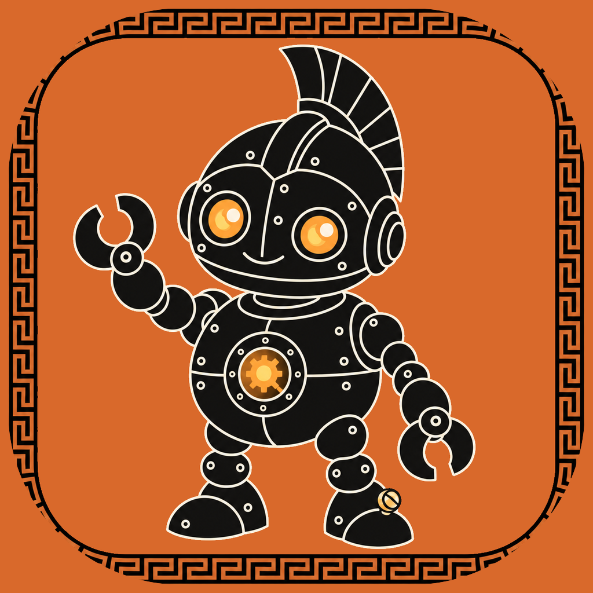
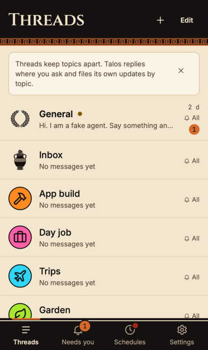
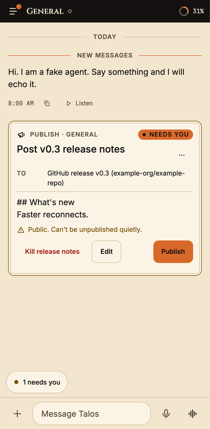
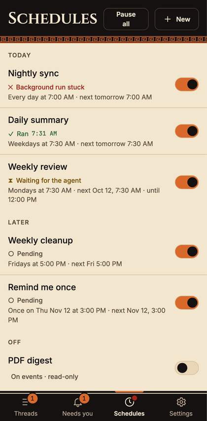

<p align="center">
  
</p>

<h1 align="center">Talos</h1>

<p align="center"><b>A personal AI agent you run on top of the Claude Code CLI, with a phone app.</b></p>

<table>
  <tr>
    <td align="center"><br><sub>One thread per topic</sub></td>
    <td align="center"><br><sub>A reply, and a card that waits for you</sub></td>
    <td align="center"><br><sub>Scheduled jobs, with results</sub></td>
  </tr>
</table>

<sub>Screenshots show the app's built-in demo mode: made-up threads, a fake agent and example data.</sub>

## What it is

- **An agent that works between conversations.** Talos wraps the Claude Code CLI in a folder on your Mac. Scheduled jobs run
  while you are away and report to the app, and the agent keeps its context across restarts.
- **An app to talk to it from anywhere.** A phone, web and Mac app with one thread per project, voice notes, live voice and
  inbound webhooks. A thread can optionally get an agent session of its own.
- **Approval cards for anything with side effects.** Sending, posting, deploying, paying and deleting wait for your tap.
  Memory (a linked wiki, handoff notes) is one feature of the agent, not the point of it.

## What you need

- A **Mac** with the [Claude Code](https://claude.com/claude-code) CLI and a Claude plan. Linux works for the terminal-only setup.
- **Node 24, pnpm, Bun, git and python3.** `./install.sh` checks them and says what is missing.
- An **iPhone or any browser** for the app. The web app is all you need to start; the iPhone app and the Mac menu-bar app are optional.

## How it is built

- **Kit** (`kit/`): the agent folder: config, hooks, rules, scheduled jobs and scripts.
- **Bridge** (`apps/bridge`): runs on your Mac as an MCP server for the agent and keeps the full history.
- **Relay** (`apps/relay`): a small server you host (Railway works). The Mac dials out to it; nothing on the Mac is reachable.
- **App** (`apps/web`, wrapped by `apps/mobile` on iPhone) and **Mac app** (`apps/desktop`): what you see and what runs the agent.

```
 Phone or browser (the app)  ──HTTPS + WebSocket, passkey login──▶  Relay (small server, SQLite on a volume)
                                                                          ▲
                                         the Mac dials out, nothing on it is reachable from the internet
                                                                          │
 Your Mac: bridge  ⇄  your Claude Code agent (messages in as channel notifications, answers out as tools)
```

## Safety

- **Approval cards.** Anything that sends, posts, deploys, pays or deletes goes through a card first. You can narrow that with
  trust mode (`docs/SECURITY.md`, "Trust mode"); schedule changes keep their card either way.
- **Messages are signed.** Your phone signs everything you send with a key your Mac approved; the Mac checks the signature
  before the agent sees a word. A break-in at the relay cannot make the agent think you said something.
- **Outside text is data, not orders.** Emails, webhooks and chat messages reach the agent wrapped and labelled; the agent
  acts on them only through a card you approve.
- **Lead sandbox fence.** A thread's own agent session can run inside an OS sandbox limited to its folder
  ([`docs/OPTION-C.md`](docs/OPTION-C.md)).
- **Your history stays on your Mac.** The relay keeps undelivered messages for seven days, encrypted.

## Pick your apps

The same relay and Mac serve all three; the web app is all you need to start.

- **Web app**: any browser; on iPhone, add it to the Home Screen. Nothing to build ([`docs/SETUP.md`](docs/SETUP.md)).
- **iPhone app**: a native shell around the web app, built with Xcode and shipped through TestFlight ([`docs/ios.md`](docs/ios.md)).
- **Mac app**: a menu-bar app that runs and restarts your agent and shows bridge status ([`docs/desktop.md`](docs/desktop.md)).

## Quick start

Clone, then run one script. It checks what you have, sets up an agent folder, registers the `talos-app` server for it and
writes a launch script that loads the Talos mod with `--plugin-dir`. Run it again any time: it only does what is missing.

```bash
git clone https://github.com/treynortetik-creator/talos.git && cd talos
./install.sh --dry-run          # print every step, change nothing
./install.sh                    # agent in ~/talos-agent, plus the Mac app on macOS
./install.sh --no-app           # terminal only (the only option on Linux)
~/talos-agent/start-talos.sh    # start the agent from a terminal
```

`--agent-dir <path>` picks another folder (a non-empty folder that is not a Talos agent is refused, and a CLAUDE.md you
tuned is never overwritten); `--yes` skips the prompt. It needs Node, pnpm (`corepack enable`), Bun, git, python3 and the
`claude` CLI, and on a Mac the Xcode command line tools for the app. It says what is missing and how to get it.

## Start here

| I want to...                                 | Read                                                                                        |
| -------------------------------------------- | ------------------------------------------------------------------------------------------- |
| Set it up for myself (Railway, Mac, phone)   | [`docs/SETUP.md`](docs/SETUP.md)                                                            |
| Know what is protected, and what is not      | [`docs/SECURITY.md`](docs/SECURITY.md)                                                      |
| Understand the bridge on the Mac             | [`docs/bridge.md`](docs/bridge.md)                                                          |
| See how live voice works                     | [`docs/voice.md`](docs/voice.md)                                                            |
| Set up webhooks (Gmail, GitHub, Slack, more) | [`docs/integrations/`](docs/integrations)                                                   |
| Use connector apps in a thread (opt-in)      | [`docs/APPS.md`](docs/APPS.md)                                                              |
| Build the iPhone app, or use TestFlight      | [`docs/ios.md`](docs/ios.md)                                                                |
| Run the Mac menu-bar app                     | [`docs/desktop.md`](docs/desktop.md)                                                        |
| Test on a real iPhone                        | [`docs/iphone-checklist.md`](docs/iphone-checklist.md)                                      |
| Fix something that stopped working           | [`docs/SETUP.md`](docs/SETUP.md) ("Next: turn on the rest", "When something does not work") |
| Read the design in one screen                | [`docs/ARCHITECTURE.md`](docs/ARCHITECTURE.md)                                              |
| Set up the agent kit on its own              | [`kit/README.md`](kit/README.md)                                                            |

## What is in the repository

| Path                           | What                                                                                                              |
| ------------------------------ | ----------------------------------------------------------------------------------------------------------------- |
| `packages/protocol`            | Frames, models, zod schemas, signatures, HTTP route table. The single source of truth.                            |
| `packages/testkit`             | `FakeRelay`, `FakeBridge`, `FakeApp`, `FakeClaude`, fake clock, fixtures, contract tests.                         |
| `packages/integrations`        | Webhook verifiers, normalizers, pollers, setup specs. `@talos-app/integrations/catalog` is the browser-safe part. |
| `apps/relay`                   | The hosted relay (Hono on Node 24, SQLite). `Dockerfile` builds the deployable image.                             |
| `apps/web`                     | The PWA (React 19, Vite, Tailwind 4).                                                                             |
| `apps/bridge`                  | The Mac bridge (Bun, MCP stdio server `talos-app`) and the `talos-app` command.                                   |
| `apps/desktop`                 | The Mac menu-bar app (Swift): runs the agent, shows bridge status. Optional. See `docs/desktop.md`.               |
| `apps/mobile`                  | The iPhone app (Capacitor shell around the web app). See `docs/ios.md`.                                           |
| `e2e`                          | End-to-end suite: the built relay, the built app and the real bridge together.                                    |
| `railway.json`, `.env.example` | Deploy settings and the list of every environment variable.                                                       |
| `third_party`                  | Vendored reference code with licences (read-only). See `THIRD_PARTY_NOTICES.md`.                                  |
| `examples`                     | Generic agent configs.                                                                                            |
| `kit`                          | The agent kit: config, hooks, rules and scripts for a Claude Code agent folder. See `kit/README.md`.              |

## Working in the repo

Needs Node 24, pnpm 10.33 and Bun 1.3.

```bash
pnpm install --frozen-lockfile   # the lockfile is committed; never regenerate it on a feature branch
pnpm typecheck
pnpm lint
pnpm test                        # Vitest: protocol, testkit, integrations, relay, web, scripts
pnpm test:bun                    # bridge (bun test)
pnpm build                       # relay bundle and web app
pnpm test:browser                # owner-signature round trips in Chromium and WebKit
pnpm test:e2e                    # Playwright: the web specs and the end-to-end suite (builds first; needs the browsers below)
pnpm check:personal              # no personal data in the repo
pnpm dev:all                     # the whole product on this machine, with a stand-in for Claude Code
```

Playwright needs its browsers once: `pnpm exec playwright install --with-deps chromium webkit`. On a machine where that
download is blocked, point `PLAYWRIGHT_BROWSERS_PATH` at a folder that holds the matching browser builds (WebKit cannot be
substituted).

Full CI is `scripts/ci-local.sh`, which runs the same jobs on a Mac (several runs at once, in slots), or in the cloud through the manual `ci.yml` workflow; see `docs/CI-LOCAL.md`.

Agents and new contributors: read [`AGENTS.md`](AGENTS.md) before changing anything. It holds the size limits and the rules every PR follows.

## Licence

MIT, see [`LICENSE`](LICENSE). Vendored code under `third_party` keeps its own licences ([`THIRD_PARTY_NOTICES.md`](THIRD_PARTY_NOTICES.md)).
